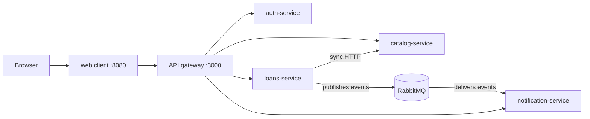

# ShelfLink

A browser-based library lending platform built as four independent microservices, an API gateway and a web client. Node.js throughout, one `docker compose up` to run it.



## Quick start

Requires Docker Desktop (running).

```bash
docker compose up --build
```

Then open **http://localhost:8080**, create an account, and borrow a book.

| URL | What it is |
|---|---|
| http://localhost:8080 | The web application |
| http://localhost:3000/health | API gateway health check |
| http://localhost:15672 | RabbitMQ management UI (guest / guest) |

Stop everything with `Ctrl+C`, then `docker compose down`. Add `-v` to also wipe the databases.

## Documentation

All project documentation lives in [`docs/`](docs/README.md), with Mermaid diagrams throughout.

| Document | Contents |
|---|---|
| [Overview](docs/01-overview.md) | Goals, scope, services, technology choices |
| [Architecture](docs/02-architecture.md) | Component, deployment and security diagrams |
| [Communication](docs/03-communication.md) | Sync vs async, sequence diagrams for every flow and failure |
| [Data model](docs/04-data-model.md) | Per-service databases and ownership |
| [API reference](docs/05-api-reference.md) | Every endpoint, gateway routing |
| [Running and testing](docs/06-running-and-testing.md) | Setup, demo script, troubleshooting |
| [Design decisions](docs/07-design-decisions.md) | Trade-offs, limitations, defense Q&A |

## Repository layout

| Folder | Purpose |
|---|---|
| `services/auth` | Accounts, login, JWT issuing |
| `services/catalog` | Books and copy availability |
| `services/loans` | Borrow and return, publishes events |
| `services/notifications` | Consumes events, stores user notifications |
| `gateway` | Single entry point, routes to services |
| `web` | Browser UI plus a proxy to the gateway |
| `docs` | Project documentation |
